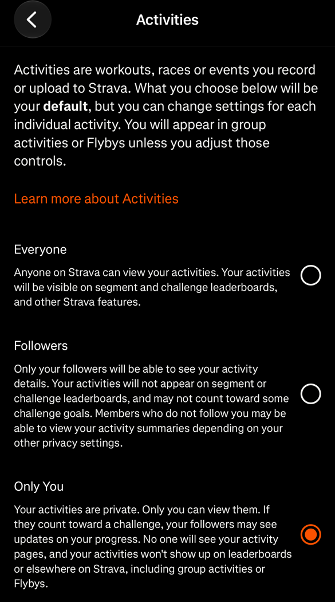
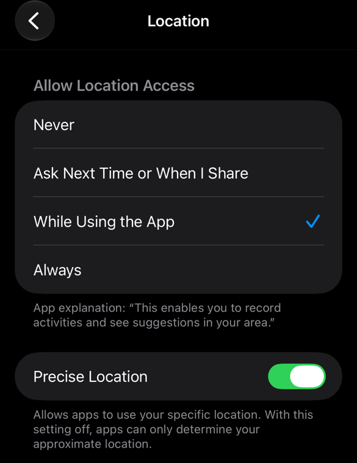
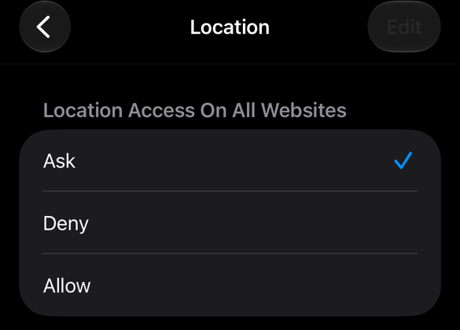

# Fieldwork Preparation

On the field trip to Catalonia, your group will collect its own spatial data: the **route** you walk, and the **sites** you record for your Urban Project. After the trip, in the mapping sessions, we will put these data on a map, combine them with other data, and turn them into a story map. Anything you do not collect in Catalonia cannot be collected afterwards, so this week is all about making sure that everything works *before* you travel.

::: {.callout-important}
## Before the session: set up and test walk
Please work through the [Before the session](#before-the-session) section below. It takes about 20 minutes, most of which is spent walking. There is nothing to hand in, but do bring your phone to the session, with your test walk saved in Strava.
:::

::: {.callout-important}
## Every working group has its own survey link
In Catalonia, your working group logs its sites with its *own* link to the field survey, which you find on the [Field Survey Links]() page. The link fills in your fieldwork group and working group number for you, so that every site ends up with your group. Only ever use your own group's link. The test link is only for signing in and testing, before and during the session.
:::

::: {.callout-note}
## Doing your fieldwork in London?
This page is written for the field trip to Catalonia, but the same instructions apply to you. Wherever it says *Catalonia*, read *London*, and use the London links on the [Field Survey Links]() page.
:::

## Spatial data and GIS
Almost everything geographers study happens *somewhere*. **Spatial data** record not only *what* something is, but also *where* it is. A photo of a street vendor is data; the same photo together with the coordinates of where it was taken is spatial data, because we can place it on a map and relate it to everything else around it: the route you walked, the neighbourhood it sits in, or the census statistics for that area.

Most spatial data take one of three basic shapes:

- **Points**: a single location, such as a site you record or a bus stop.
- **Lines**: a sequence of locations, such as the route you walk.
- **Polygons**: an area with a boundary, such as a neighbourhood or a census district.

Locations are stored as **coordinates**: the *latitude*, which is the position north or south of the equator, and the *longitude*, which is the position east or west of the meridian through Greenwich. Plaça de Catalunya in Barcelona, for instance, is at about 41.387° N, 2.170° E. Your phone works out its coordinates using satellite positioning (GPS). Outdoors, this is typically accurate to within 5 to 10 metres, but the accuracy drops between tall buildings and indoors, which is worth keeping in mind when you record sites in narrow streets.

A **geographic information system (GIS)** is software for storing, combining, analysing and mapping spatial data. Because every record has a location, a GIS can overlay datasets that were collected separately, such as your sites, your route, a street map and census data, and help us answer questions about *where* things happen and *what* is near what. In this module, we will use ArcGIS Online, a GIS that runs in your web browser.

## What you will collect
Your group will collect two datasets: your route as a line, and your sites as points. Each of these is collected with a different tool:

| What       | Tool | How it works |
| :--------- | :--- | :----------- |
| Your route | [Strava](https://www.strava.com) | A phone app that records your GPS track in the background, also without mobile data. You export it afterwards as a `.gpx` file. |
| Your sites | [UCL Geography Field Survey]() | A web form that opens in your phone's browser. Each working group has its own link, which fills in your group for you. Each entry records your location, a photo and a short note, and goes straight into ArcGIS Online, so there is no need to copy coordinates by hand. |

Both datasets are collected once per working group. One or two people in your group record the route, and one person is responsible for logging the sites in the field survey, so you will need to agree who does what. Everyone does the setup and the test walk below, though, so that anyone can step in if a phone runs out of battery.

::: {.callout-note}
## If your screen looks different
Apps and websites change their layout regularly. This chapter therefore describes *what* to tap by its label (e.g. [Record]{.ui}) rather than relying on screenshots. If a label has moved or been renamed, look for the closest equivalent, and ask in class if you cannot find it.
:::

## Before the session
Please work through the steps below in the week before the session.

### Set up Strava
Let us start by installing Strava and making sure that your activities are not visible to anyone else:

1. Install Strava from the App Store or Google Play and create a free account. You do not need a paid subscription. Do remember your login details, because you will need them on the Strava website later.
2. When the app asks for location access, allow it **While Using the App**.
3. Make your activities private by tapping the [You]{.ui} tab, then the settings cog (top right), and going to [Privacy Controls]{.ui} → [Activities]{.ui} → [Only You]{.ui}. You can still export private activities.

   {width=260 fig-alt="Strava privacy settings with activities set to Only You"}

### Check your location settings
Both Strava and your web browser (which you will use for the field survey) need access to your location. On an iPhone, you can find both settings under [Settings]{.ui} → [Apps]{.ui}:

1. For Strava, go to [Settings]{.ui} → [Apps]{.ui} → [Strava]{.ui} → [Location]{.ui}. Select [While Using the App]{.ui} and keep [Precise Location]{.ui} switched on.

   {width=260 fig-alt="iPhone location settings for Strava set to While Using the App, with Precise Location on"}

2. For Safari, go to [Settings]{.ui} → [Apps]{.ui} → [Safari]{.ui}, and scroll a long way down to [Location]{.ui}. Select [Allow]{.ui} or [Ask]{.ui}, but not [Deny]{.ui}.

   {width=260 fig-alt="iPhone Safari location settings with the options Ask, Deny and Allow"}

On Android, go to [Settings]{.ui} → [Apps]{.ui} → [Strava]{.ui} → [Permissions]{.ui} → [Location]{.ui}, choose [Allow only while using the app]{.ui} and switch on [Use precise location]{.ui}. You can then do the same for [Chrome]{.ui}.

### Sign in to the field survey
Next, we will make sure that you can open the field survey and sign in to it:

1. On your phone, open the [Field Survey Links]() page and tap [Open the test survey]{.ui}. The survey opens in your browser, so there is nothing to install.
2. Sign in with your UCL account. If you are asked for *Your ArcGIS organization's URL*, type `uclondon`, tap [Continue]{.ui} and then [UCL SSO]{.ui}, and sign in as you would for Moodle. You do not need to fill in the survey yet.

### Do a test walk
Finally, let us check that Strava actually records your route by going for a short test walk:

1. Somewhere outside, open Strava, tap [Record]{.ui}, choose [Walk]{.ui} as the activity type, and start recording. You can lock your phone while you walk, as Strava keeps recording in the background.
2. Walk for about 10 minutes.
3. Stop the recording ([Stop]{.ui} → [Finish]{.ui}), name the activity `GEOG0187 test walk`, and [Save]{.ui} it.
4. Check that your route looks right on the map, and take note of how much battery the walk used.

### Bring to the session
Please bring the following with you to the session:

- your phone, charged, with the test walk saved in Strava;
- your Strava login details;
- a note of anything that did not work, or that you were unsure about.

## In the session
The session has two parts. First, we will check that the tools work: that you can get your route out of Strava and submit an entry to the field survey. Then, you will plan with your working group how you will collect your data in Catalonia.

### Test the tools
We will start with a live demonstration of a test walk done with the same instructions, showing you how to get the route out of Strava, how to fill in the field survey, and what the data look like in ArcGIS Online. You will then do the same yourself:

1. **Export your test walk.** The `.gpx` file can only be downloaded from the Strava website, not from the app, so you will need a laptop or computer for this step. Log in at [strava.com](https://www.strava.com), open your test walk, open the [⋯]{.ui} (more actions) menu next to the activity, and choose [Export GPX]{.ui}. Check that a `.gpx` file has been downloaded.
<!-- SCREENSHOT 4: Strava website, activity page with the ⋯ menu open and "Export GPX" visible. images/w01/strava-export.png -->
2. **Try the field survey.** Open the [test survey](#test-link) and submit one test entry from the room:
   - **Data collection** and **Working group number** are already filled in as `Fieldwork - Test` and `0`, and cannot be changed.
   - For **Site ID**, enter `S00`.
   - For **Location**, tap [Allow]{.ui} when asked, and check that the dot on the map is roughly where you are. If it is not, wait a few seconds or drag it to the right spot.
   - For the **photo** and the **short note**, anything will do.
   - Tap [Submit]{.ui} and check that you see a confirmation.
<!-- SCREENSHOT 5: the field survey on an iPhone, filled in, with the location map visible. images/w01/survey-form.png -->
3. **Fix any problems.** If something did not work, try to sort it out first with your working group and the students around you, using the [troubleshooting table](#troubleshooting), which covers the most common issues. If you are still stuck, or have any other questions, ask the teaching staff for help.

By the end of this part, everyone should have exported a `.gpx` file and submitted one test entry from their own phone.

::: {.callout-warning}
## Sort it out now, not in Catalonia
Time in the field is limited, and you do not want to spend it on fixing settings, finding passwords or working out how the survey works. Anything that does not work today is much easier to fix here, with help at hand, than on a street corner in Catalonia.
:::

### Plan your fieldwork
Next, sit down with your working group and agree how you will collect your data once you are in Catalonia:

- **Who records the route.** Choose one or two people to record the route in Strava. With two, you still have a route if one recording fails. These people will also export the route after the trip and share it with the rest of the group.
- **Who logs the sites.** Choose one person to be responsible for logging the sites in the field survey. The whole group decides what to record, but only this person submits the entries, so that each site is entered only once.
- **Who takes over.** Agree who takes over the route recording or the site logging if one of these phones runs out of battery.
- **Which sites.** Discuss what kind of sites you will record and how they relate to your Urban Project theme.
- **Site IDs.** Number your sites `S01`, `S02`, `S03`, and so on, within your group, and use the same ID in the survey and on any notes, photos or recordings you make outside it. This is how you will match them to your points on the map later on.

Finally, whoever logs the sites, and whoever takes over from them, saves your group's survey link to their phone:

1. Open the [Field Survey Links]() page, find your fieldwork group and working group number, and tap your group's link.
2. Check that the top of the form shows *your* fieldwork group and working group number.
3. Add the survey to your home screen. In Safari, use [Share]{.ui} → [Add to Home Screen]{.ui}; in Chrome, use the [⋮]{.ui} menu → [Add to Home screen]{.ui}. Give it a name you will recognise, such as `Survey WG05`.
4. Open the survey from the new home screen icon, and show it to a member of the teaching staff before you leave the session, so that we can check together that it shows your group.
5. Close the survey without submitting anything. You will use it for the first time in Catalonia.

## In Catalonia
Once you are in Catalonia, there are a few things to keep in mind:

- Whoever logs the sites opens the survey from the home screen icon you saved in the session, and submits one entry per site while standing at the site. Your fieldwork group and working group number are filled in for you, so you only add the site ID, location, photo and note.
- Whoever records the route starts Strava when the group starts walking, and stops it when you finish. One recording per outing is fine, and you can have several recordings in total.
- Charge your phone every night and bring a power bank if you have one, because GPS and the camera use more battery than usual.
- If you have no signal or no mobile data, Strava will keep recording and upload your route once you are back online. The survey, however, needs a connection to submit. If you have none, take a photo with your camera, note the site ID and time in your notebook, and submit the entry later, placing the point by dragging the dot to the right location on the map.
- Please be considerate. Survey entries can be seen by anyone at UCL with an ArcGIS Online account, so avoid photos in which people can be identified, keep personal details out of your notes, and follow the ethics guidance in your Urban Project worksheet. Do not record your accommodation as a site.

::: {.callout-tip}
## Check your roaming charges
Before you travel, check whether your phone contract includes mobile data in Spain, and what it costs if it does not. If in doubt, switch off mobile data and rely on wifi: Strava records without a connection, and you can submit survey entries later.
:::

## After the trip
Your sites will already be in ArcGIS Online, but there are two things to do before the next session:

1. **Export and share the route.** Whoever recorded the route downloads the `.gpx` file(s) from the Strava website, just as you did in the session, and shares them with the rest of the working group. If two people recorded, their routes should be the same, so one copy is enough; pick the one with the fewest gaps.
2. **Share everything else.** Put any extra photos, videos and notes in a shared OneDrive or Google Drive folder for your working group. It is best to avoid WhatsApp for photos, because it compresses them and removes their location information.

## Troubleshooting
| Problem | What to try |
| :------ | :---------- |
| Strava does not record, or the route is a straight line | Check that location access is set to [While Using the App]{.ui} with [Precise Location]{.ui} on. Do not force-close the app while recording, and turn off Low Power Mode if the route has gaps. |
| There is no [Export GPX]{.ui} option | Use the Strava website on a laptop, not the app or a phone browser. You can only export your *own* activities, so the export has to be done by whoever recorded the route, who then shares the file with the group. |
| The form shows the wrong fieldwork group or working group number | You have opened the wrong link. Remove the icon from your home screen, open your own group's link from the [Field Survey Links]() page, and save that one instead. |
| **Data collection** or the group number is empty | The link lost its details, for instance because you had to sign in first. Close the form without submitting, open your group's link again from the [Field Survey Links]() page, and save that one to your home screen instead. |
| The survey asks me to sign in again | Sign in as you did during the setup: organisation URL `uclondon`, then [UCL SSO]{.ui}. You may need to do this again after a while, also in Catalonia. |
| The survey cannot find my location | Allow location access for your browser (see above), then reload the form. Your phone finds its location fastest outdoors with a clear view of the sky, so if you are inside or in a narrow street, move outside or to a wider street and wait up to a minute. |
| The point is in the wrong place | Drag the dot on the map to the correct location before submitting. |
| There is no confirmation after [Submit]{.ui} | Check that you have a connection, then tap [Submit]{.ui} again. Any required fields that are missing are highlighted in the form. |
| The photo will not upload | Try again on wifi, or submit without the photo and write the site ID down alongside the photo instead. |
