# Mapping Your Field Data

In Catalonia (or London), your working group recorded sites using the field survey, and recorded your route in Strava. This week, we will bring the two together on one map in **ArcGIS Online**. Everyone makes their own map. Next week, you will turn this map into a [story map](), so please make sure you save it at the end of the session.

::: {.callout-important}
## Before the session
Make sure you have a copy of your working group's route as a `.gpx` file, exported from the Strava website by whoever recorded it (see [After the trip](#after-the-trip)), and that you know your fieldwork group and working group number. You can look these up in your working group's link on the [Field Survey Links]() page.
:::

## Layers and attributes
In Session 1, we saw that spatial data come as **points**, **lines** and **polygons**. A GIS keeps each dataset as a separate **layer**, and stacks these layers on top of each other to make a map. On our map, we will have three of them:

- Your sites form a point layer, with one point per survey entry.
- Your route forms a line layer: the track that Strava recorded.
- The basemap at the bottom is the background (streets, satellite imagery, terrain) that gives your data context.

Each feature in a layer also carries **attributes**: the information stored about it, such as the site ID, note and photo you entered in the survey. In ArcGIS Online, you can see a feature's attributes in its **pop-up** when you click on it. You can also use attributes to **filter** a layer, so that only some features are shown, or to **style** it, for instance by colouring points by category.

A map on a flat screen is always a *projection* of the curved Earth, which distorts distances and areas to some extent. ArcGIS Online takes care of this for us, so we will not need to worry about it in this module.

::: {.callout-note}
## If your screen looks different
ArcGIS Online changes its layout regularly. This chapter therefore describes *what* to click by its label (e.g. [Add]{.ui}). If a label has moved or been renamed, look for the closest equivalent, and ask in class if you cannot find it.
:::

## Open Map Viewer
Let us start by signing in to ArcGIS Online and opening an empty map:

1. Go to [](), click [UCL SSO]{.ui}, and sign in as you would for Moodle. Please use a laptop or computer for this, not your phone.

   ![Signing in to ArcGIS Online with [UCL SSO]{.ui}.](images/w02/sign-in.png){#fig-sign-in width=360 fig-alt="ArcGIS Online sign-in page for University College London with a UCL SSO button"}

2. Open [Map]{.ui} from the top menu. This opens **Map Viewer** with an empty map.

   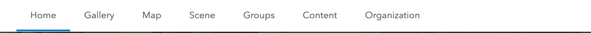{#fig-home fig-alt="ArcGIS Online top menu with Home, Gallery, Map, Scene, Groups, Content and Organization"}

3. Take a moment to look around. The left-hand toolbar holds what is *in* your map ([Add]{.ui}, [Layers]{.ui}, [Basemap]{.ui}, [Save and open]{.ui}), whilst the right-hand toolbar holds the settings for the selected layer ([Properties]{.ui}, [Styles]{.ui}, [Filter]{.ui}, [Pop-ups]{.ui}). The right-hand toolbar only shows icons: hover over an icon to see its name, or click the [«]{.ui} button at the bottom of the toolbar to expand it so that the names are shown.

   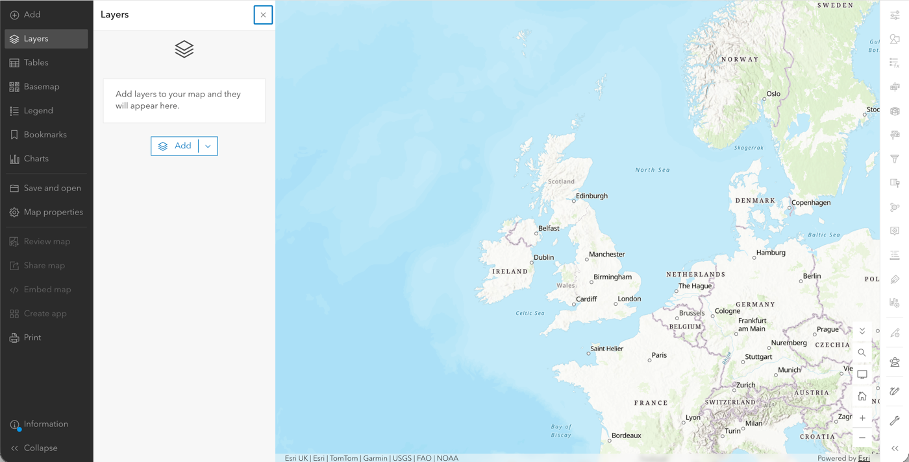{#fig-map-viewer fig-alt="Map Viewer with an empty map of Europe, the left-hand toolbar with Add, Layers and Basemap, and an icon toolbar on the right"}

## Choose a basemap
Click [Basemap]{.ui} and try a few of the options. A quiet basemap such as *Light Gray Canvas* or *OpenStreetMap Style* makes your own data stand out, whereas *Imagery* shows what the places look like from above. You can change the basemap again at any time.

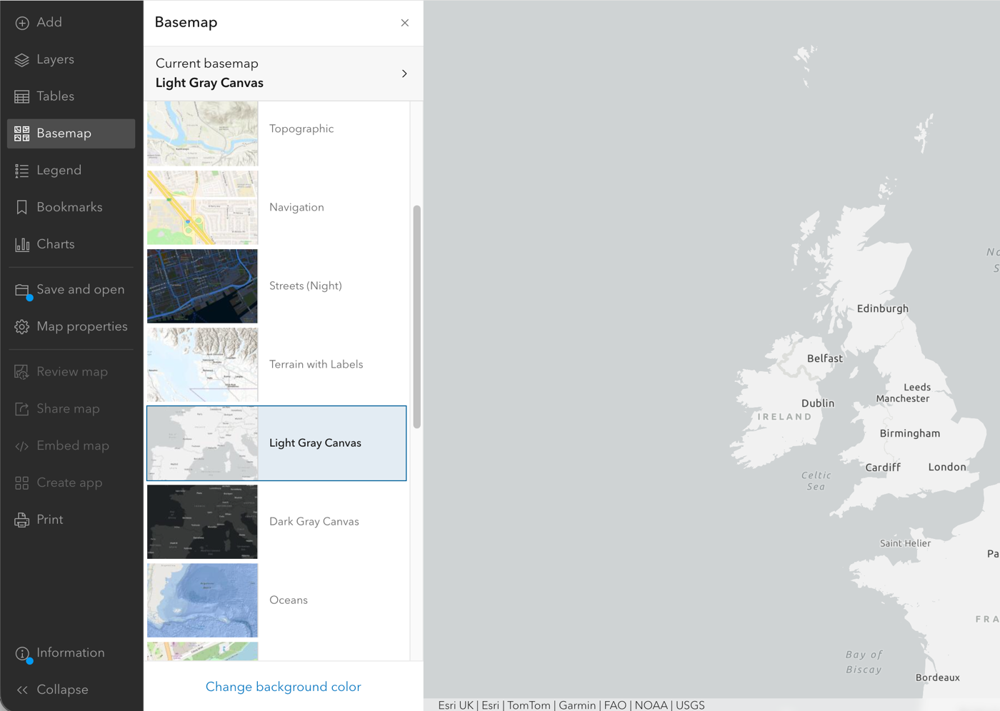{#fig-basemap width=560 fig-alt="Basemap pane with Light Gray Canvas selected, and the map in light grey"}

## Add your working group's sites
All field survey entries, from every group, are stored in a single layer. We will add that layer to our map and then filter it so that only your own working group's sites are shown:

1. Click [Add]{.ui} → [Browse layers]{.ui}.

   ![The [Add]{.ui} menu.](images/w02/add-menu.png){#fig-add-menu width=420 fig-alt="The Add menu in Map Viewer with Browse layers, Add layer from URL and Add layer from file"}

2. At the top of the panel, switch from [My content]{.ui} to [My organization]{.ui}, and search for ``. Make sure you pick the layer whose name ends in `_results`: there are other items with a very similar name, which will not work.

   ![The survey layers in [Browse layers]{.ui}, with [My organization]{.ui} selected.](images/w02/browse-layers.png){#fig-browse-layers width=340 fig-alt="Browse layers panel set to My organization, listing UCL Geography Field Survey_results, UCL Geography Field Survey_form and UCL Geography Field Survey, each with an Add button"}

3. Click [Add]{.ui} on the `_results` layer, and close the browse panel. The layer now appears under [Layers]{.ui}, with the entries of the whole year. The map may not zoom to the points by itself; we will zoom in once we have filtered the layer.
4. In [Layers]{.ui} (left-hand toolbar), click the survey layer so that it is highlighted. Then click [Filter]{.ui} on the right-hand toolbar (the funnel icon).

   ![The survey layer added to the map, with [Filter]{.ui} on the right-hand toolbar.](images/w02/layer-added.png){#fig-layer-added fig-alt="Map Viewer with the survey results layer in the Layers list, two points near Gordon Square, the Properties pane open and the Filter tooltip on the right-hand toolbar"}

5. Click [Add new]{.ui}, and set up the following conditions:
   - **Data Collection** *is* your fieldwork group:
     - `Fieldwork - Catalonia Group 1` if you were in Catalonia from 23 to 27 January;
     - `Fieldwork - Catalonia Group 2` if you were in Catalonia from 27 to 31 January;
     - `Fieldwork - London` if you did your fieldwork in London.
   - Click [Add new]{.ui} again, choose **Working Group Number**, change the operator from *is at least* to *is*, and enter your working group number (e.g. `5`). Do not leave it on *is at least*: that keeps every working group with a higher number too.
   - Click [Save]{.ui}. Only your working group's sites should now be visible.

   {#fig-filter fig-alt="Filter pane with two conditions: Data Collection is Fieldwork - Test, and Working Group Number is 0"}

6. Zoom to your sites: in [Layers]{.ui}, open the [⋯]{.ui} menu of the layer → [Zoom to layer]{.ui}.

   ![The layer menu with [Zoom to layer]{.ui}.](images/w02/zoom-to-layer.png){#fig-zoom-to-layer width=560 fig-alt="The layer's more options menu with Zoom to layer, Show properties, Show table, Rename and Remove"}

7. Click on a point. Its pop-up shows the attributes and photo your working group entered. We will tidy up this pop-up later on.

   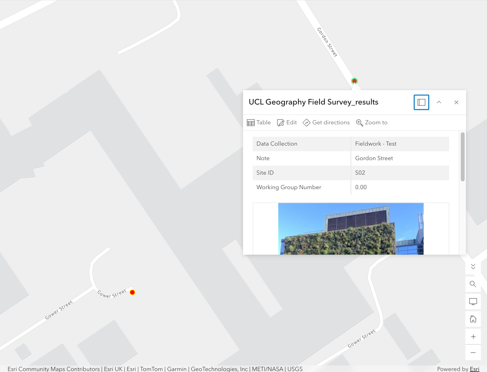{#fig-popup-default width=560 fig-alt="Default pop-up listing Data Collection, Note, Site ID and Working Group Number (0.00), with a photo underneath"}

::: {.callout-note .exercise icon=false}
## Predict first
How many sites did your working group log? Write the number down, then count the points on your filtered map. If the two do not match, check both filter conditions.
:::

Note that the filter only changes *your* map: nobody else's data are deleted or changed.

## Add your route
Next, we will add your working group's route from Strava. ArcGIS Online cannot read `.gpx` files, so we first convert the route to **GeoJSON**, a common format for spatial data that ArcGIS Online does accept.

### Convert the route to GeoJSON
1. Go to [geojson.io](https://geojson.io). There is no need to sign up.

   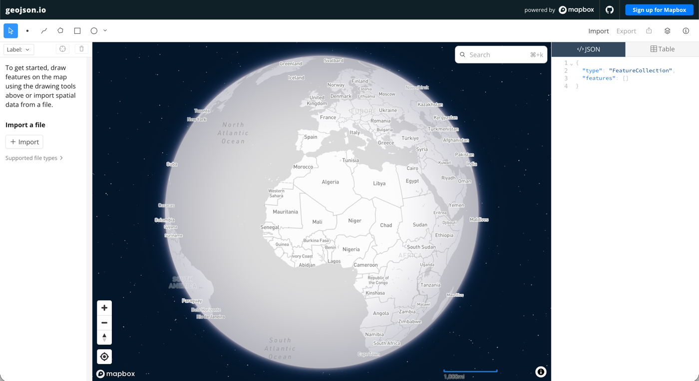{#fig-geojsonio-start fig-alt="The geojson.io website with an empty globe and an Import button on the left"}

2. Click [Import]{.ui} and select your `.gpx` file. Your route appears on the map as a line, and its data appear on the right.

   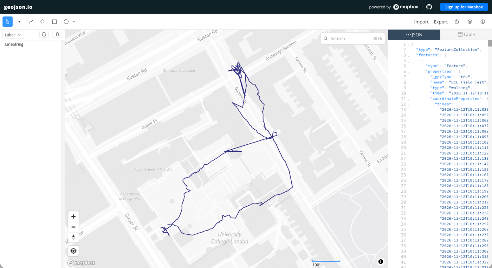{#fig-geojsonio-route fig-alt="geojson.io showing the walked route as a line around the UCL campus, with the GeoJSON text on the right"}

3. Click [Export]{.ui}, keep the file format on [GeoJSON]{.ui}, and click [Export]{.ui}. A `.geojson` file is downloaded.

   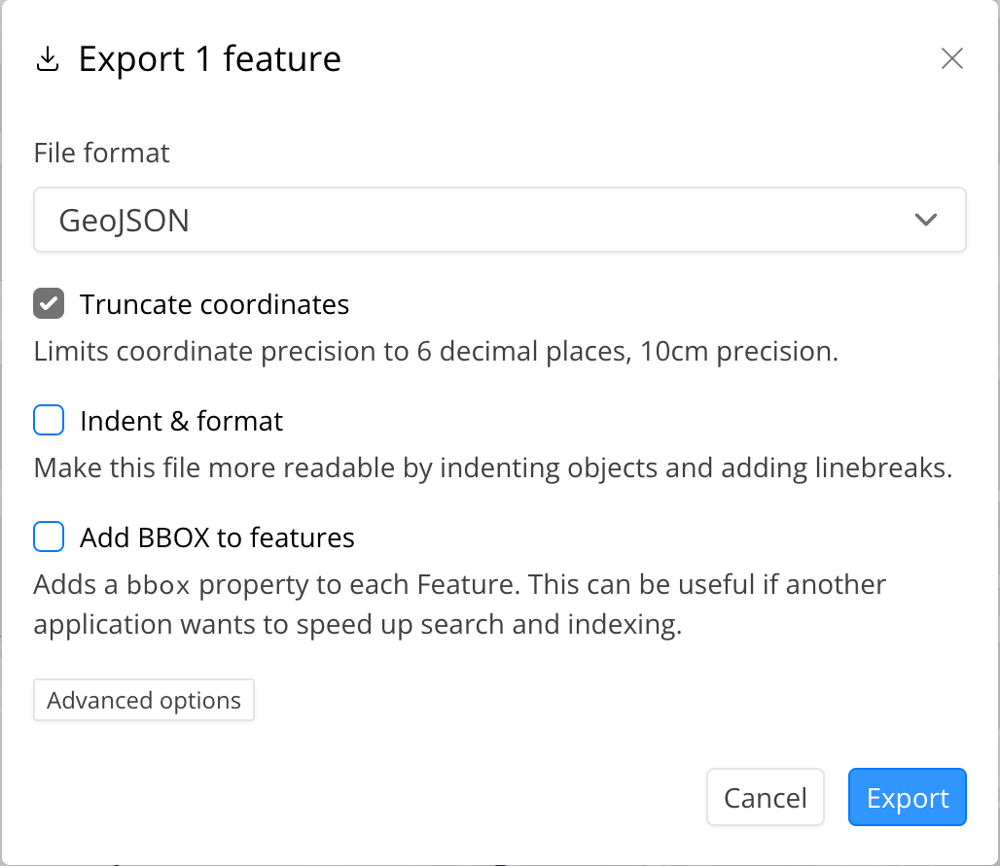{#fig-geojsonio-export width=420 fig-alt="Export dialog in geojson.io with GeoJSON as the file format and an Export button"}

### Add the route to your map
1. Back in Map Viewer, click [Add]{.ui} → [Add layer from file]{.ui}, click [Your device]{.ui}, and select the `.geojson` file.

   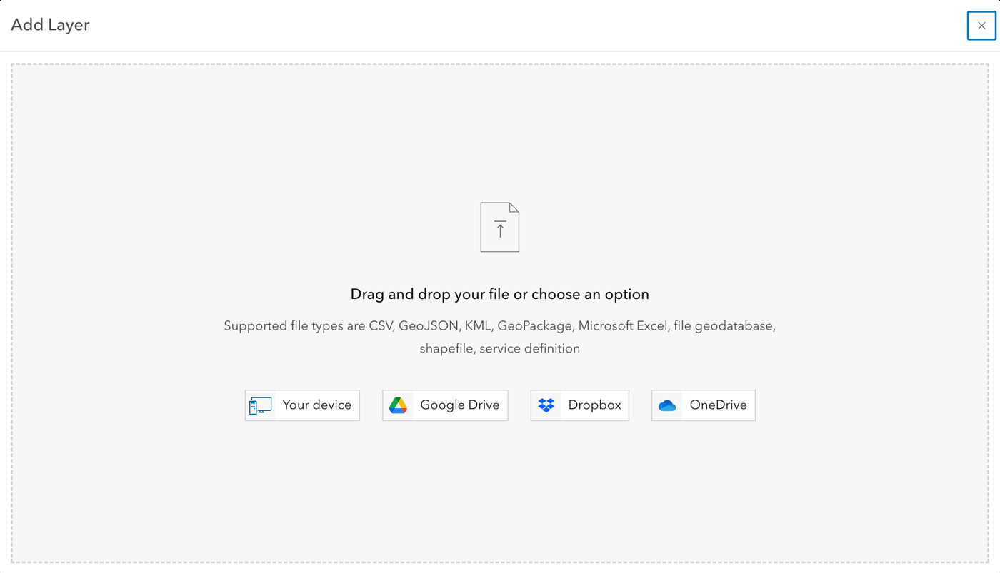{#fig-add-file fig-alt="Add Layer dialog with a drop zone, the list of supported file types and buttons for Your device, Google Drive, Dropbox and OneDrive"}

2. Choose [Create a hosted feature layer and add it to the map]{.ui}, so that the route is stored in your own ArcGIS Online content, and click [Next]{.ui}.

   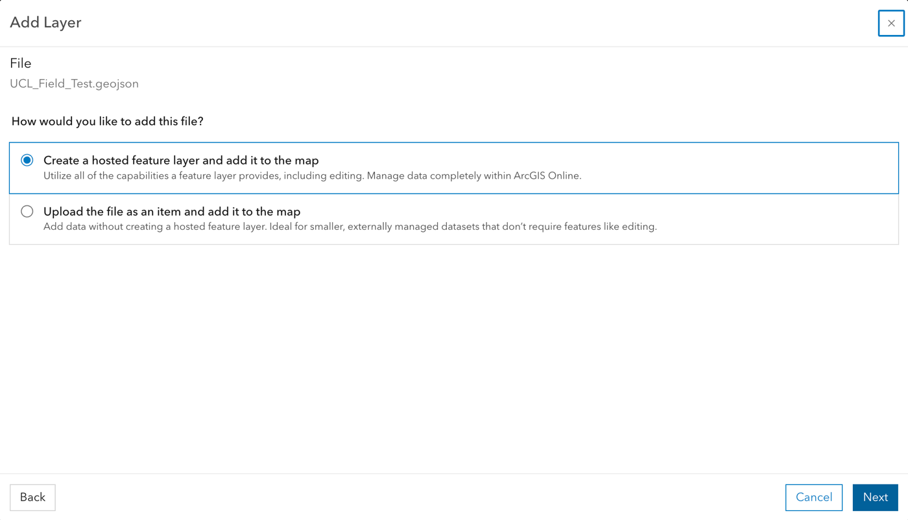{#fig-add-file-hosted fig-alt="Add Layer dialog with the option Create a hosted feature layer and add it to the map selected"}

3. Give the layer a title that starts with your group code, such as `CAT1_WG05 route`. The group code combines your fieldwork group and working group number: `CAT1_WG05` for Catalonia Group 1, working group 5 (`CAT2_` for Catalonia Group 2, `LDN_` for London). Then click [Create and add to map]{.ui}.

   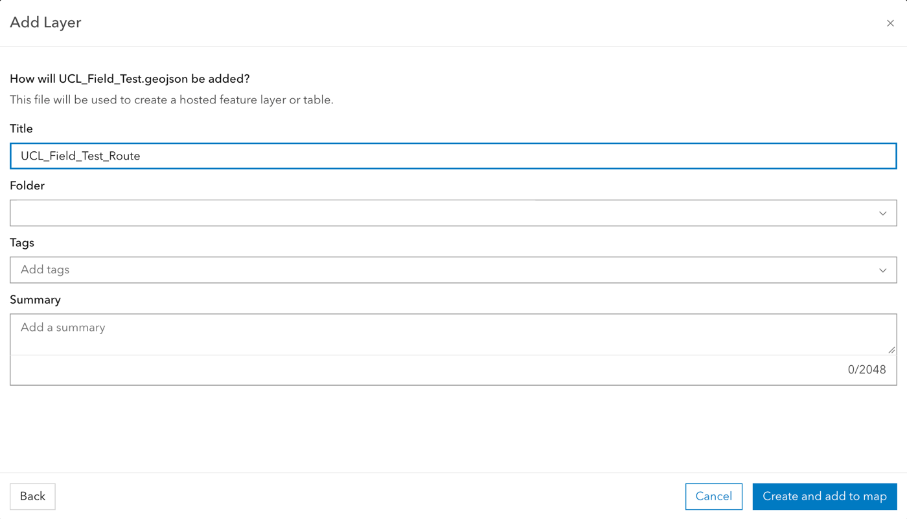{#fig-add-file-details fig-alt="Add Layer dialog with a title for the route layer and a Create and add to map button"}

4. The route now appears as a line on the map. Check that it matches where you walked. If you have several recordings, you can convert and add each of them in the same way.

   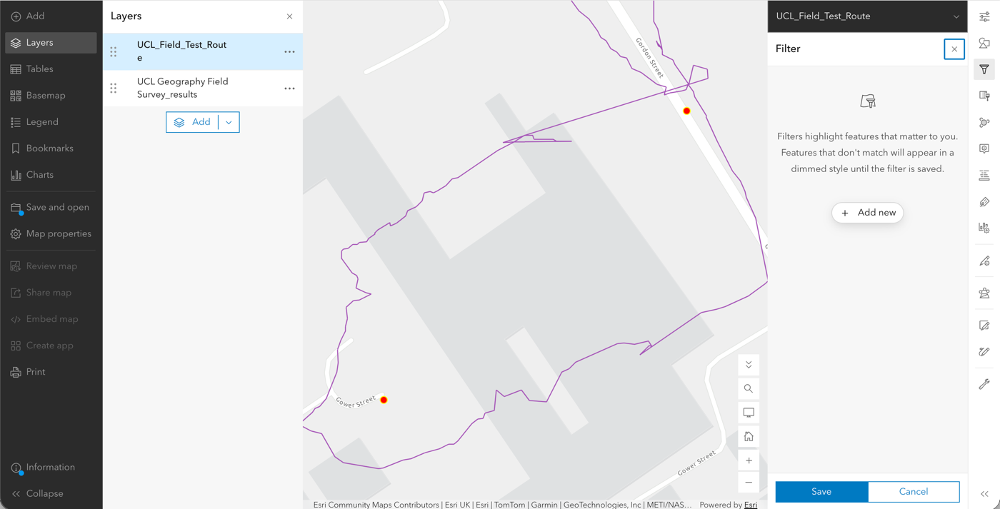{#fig-route-added fig-alt="Map Viewer with the route layer above the survey layer, and the route drawn as a thin purple line"}

If you do not have your working group's `.gpx` file yet, you can practise with the [route from the live demonstration]() (use the download button on the right), and add your own route later in the same way.

::: {.callout-tip}
## Save early
Save your map now, via [Save and open]{.ui} → [Save as]{.ui}, with the title from [Save your map](#save-your-map). From then on, use [Save and open]{.ui} → [Save]{.ui} every now and then. If the session ends before you finish, your work so far is safe.
:::

## Style your layers
First, let us make the [Layers]{.ui} list, and with it the legend, readable for someone else:

1. Give both layers a clear name, such as `Survey sites` and `Route`: open the [⋯]{.ui} menu of the layer in [Layers]{.ui} → [Rename]{.ui}, type the new name and click [OK]{.ui}. This only changes the name in your map, not the original layer.

   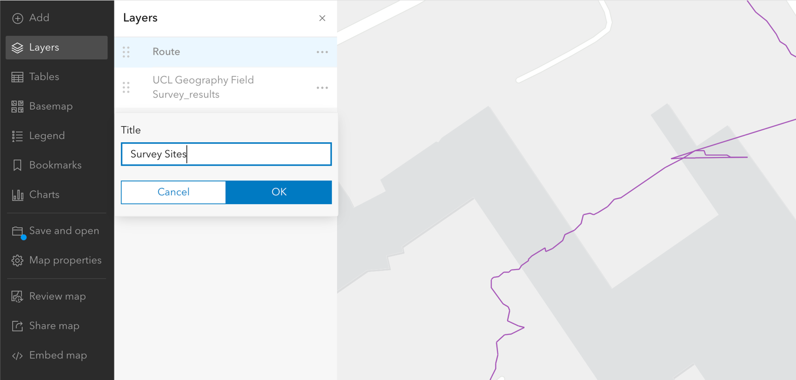{#fig-rename width=560 fig-alt="Rename box under the Layers list with the title Survey Sites and an OK button"}

2. Check the order of the layers. The layer at the *top* of the list is drawn on top of the others. Because you added the route last, it is now on top, and may hide some of your sites. Drag the sites above the route by their handle (⠿).

To change how a layer looks, select it in [Layers]{.ui} and click [Styles]{.ui} on the right-hand toolbar. Keep the [Location (single symbol)]{.ui} style, and click the pencil next to [Symbol style]{.ui}. We will style both layers in turn:

- For the route, change the line colour and width so that the route is clearly visible on your basemap.
- For the sites, change the size and fill colour so that the points stand out against the route. You could also style them by an attribute instead, but a single clear symbol is fine for now.

Click [Done]{.ui} when you are happy with a layer.

::: {layout-ncol=2}
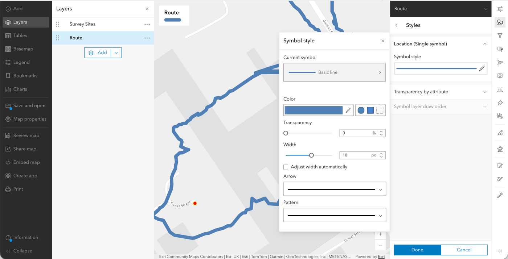{#fig-style-route fig-alt="Symbol style pane for the route with colour, transparency and a width of 10 px"}

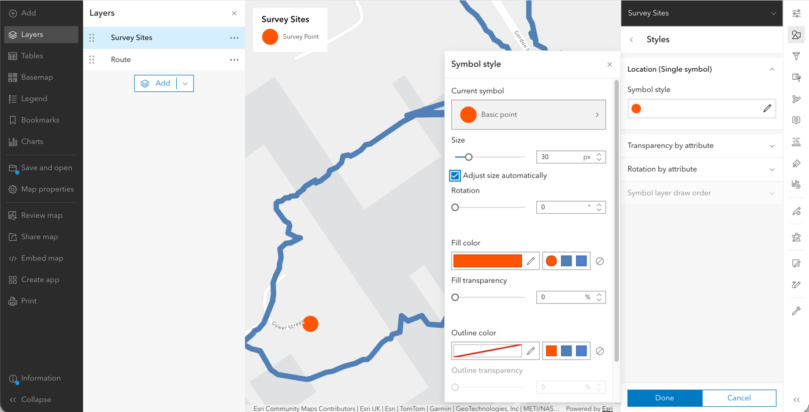{#fig-style-sites fig-alt="Symbol style pane for the survey sites with a size of 30 px and an orange fill colour"}
:::

What we are aiming for is a map that someone who was not there can read at a glance: two clearly different layers, and nothing that distracts from them.

::: {.callout-note .exercise icon=false}
## Try it yourself
Switch between two or three basemaps now that your layers are styled. Which one works best with your colours, and why? Adjust your styling if needed.
:::

## Set up the pop-ups
By default, a pop-up shows every attribute in the layer, which quickly becomes cluttered (@fig-popup-default). Let us tidy it up: click the sites layer in [Layers]{.ui}, and then [Pop-ups]{.ui} on the right-hand toolbar:

1. Set the **title** to the site ID: click the [{ }]{.ui} button next to the title, and choose **Site ID** from the list of fields.

   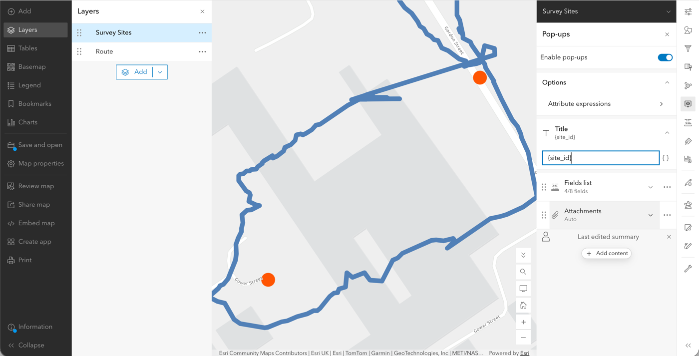{#fig-popup-title fig-alt="Pop-ups pane with the title set to {site_id} and the { } button next to it"}

2. Open [Fields list]{.ui}, click [Select fields]{.ui}, and keep only **Site ID** and **Note**.

   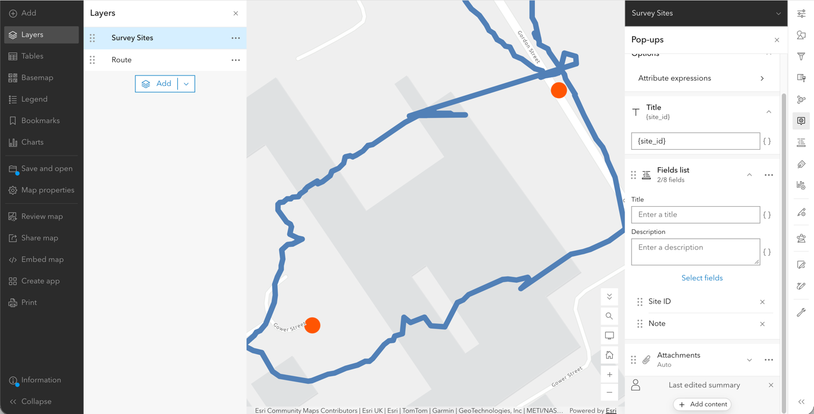{#fig-popup-fields fig-alt="Pop-ups pane with Fields list open, showing 2 of 8 fields: Site ID and Note"}

3. Check that [Attachments]{.ui} is included, so that the photo is shown.
4. Click on a few points on the map to check the result.

   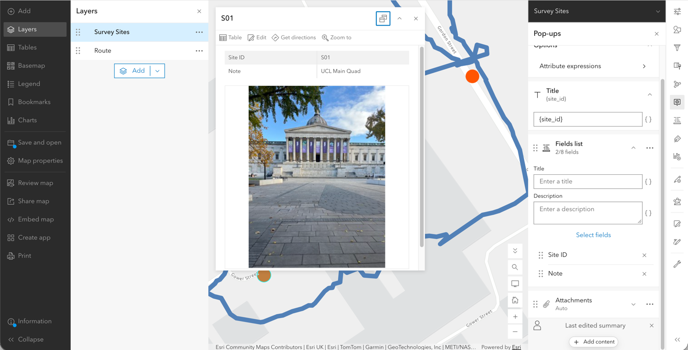{#fig-popup-final fig-alt="Pop-up titled S01 with Site ID S01, Note UCL Main Quad, and a photo of the UCL Portico"}

## Save your map
Finally, we need to save the map so that you can open it again next week:

1. Click [Save and open]{.ui} → [Save as]{.ui}.
2. Use `GEOG0187 – CAT1_WG05` as the title, with your own group code. Please do not add your name: the map ends up in your story map, which may become part of your portfolio, and the portfolio is marked anonymously. Add a short summary, for example *Sites and route from fieldwork in Barcelona*.

   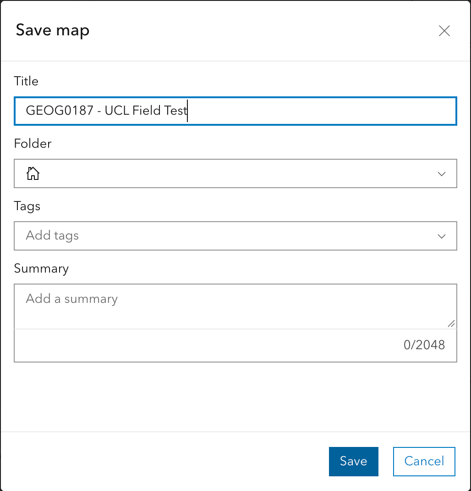{#fig-save-map width=420 fig-alt="Save map dialog with a title, folder, tags and summary, and a Save button"}

3. Click [Save]{.ui}. The map will now be in [Content]{.ui} → [My content]{.ui}.

You do not need to share the map with anyone at this point.

## Before you leave
By the end of this session, your saved map should have:

- [ ] a basemap of your choice;
- [ ] your working group's sites, and only those;
- [ ] your route as a line;
- [ ] clear styling for both layers;
- [ ] pop-ups that show the site ID, note and photo.

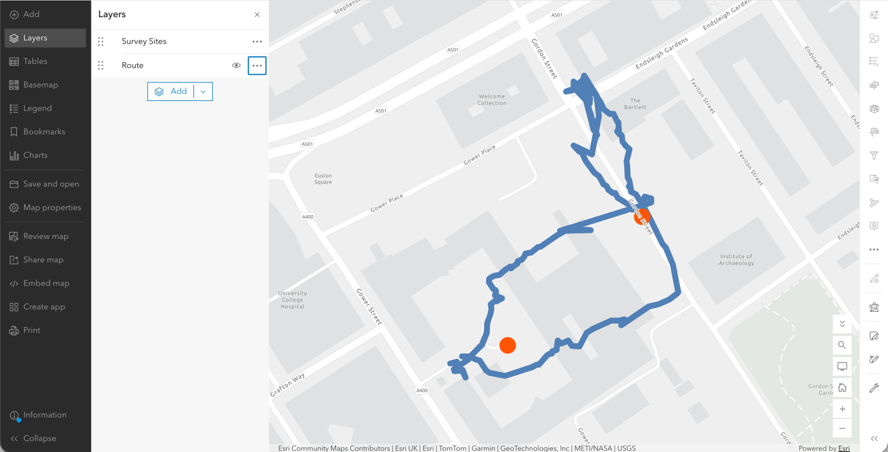{#fig-finished-map fig-alt="Finished map with a light grey basemap, the route as a thick blue line and two orange survey sites around Gordon Street"}

::: {.callout-note .exercise icon=false}
## Try it yourself
If you finish early, estimate how far your working group walked, and then check with the [Measure]{.ui} tool (under [Map tools]{.ui}, the wrench icon on the right-hand toolbar). You could also add labels with the site IDs ([Labels]{.ui}, under [More]{.ui} on the right-hand toolbar): does this make the map easier or harder to read?
:::

## Troubleshooting
| Problem | What to try |
| :------ | :---------- |
| The survey layer does not appear in the search | Check that you are searching [My organization]{.ui}, not [My content]{.ui}, and that you signed in through [UCL SSO]{.ui}. |
| No sites are left after filtering | Check that your filter uses exactly the same fieldwork group and working group number as your working group's [survey link](). If your sites are still missing, ask the teaching staff. |
| The filter shows other working groups too | Check that the **Working Group Number** condition uses *is*, not *is at least*. |
| I do not have a `.gpx` file | Ask whoever recorded the route in your working group to share it. In the meantime, you can practise with the [route from the live demonstration](). |
| ArcGIS Online does not accept my `.gpx` file | That is expected: convert it to GeoJSON first, using [geojson.io](https://geojson.io) (see [Convert the route to GeoJSON](#convert-the-route-to-geojson)). |
| geojson.io does not show a route | Check that the file ends in `.gpx` and was exported from the Strava *website*. You could also try a different browser. |
| The route is a straight line or has big jumps | The GPS signal was lost during recording. If two people in your working group recorded the route, use the other recording. |
| I cannot find the right-hand toolbar buttons | Click the [«]{.ui} button at the bottom of the toolbar to show the names, or hover over an icon. |
| The photo does not show in the pop-up | Check that [Attachments]{.ui} is switched on under [Pop-ups]{.ui}. Note that not every entry has a photo. |
| I cannot find my map next time | Go to [Content]{.ui} → [My content]{.ui}, or search for `GEOG0187`. |
