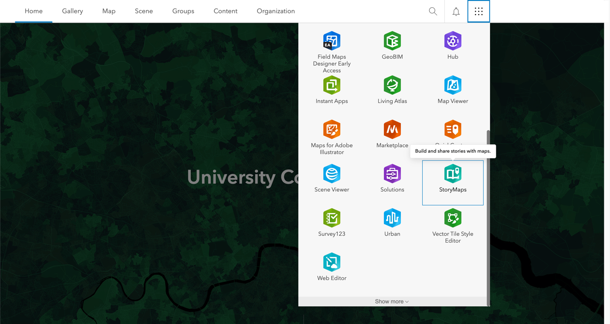
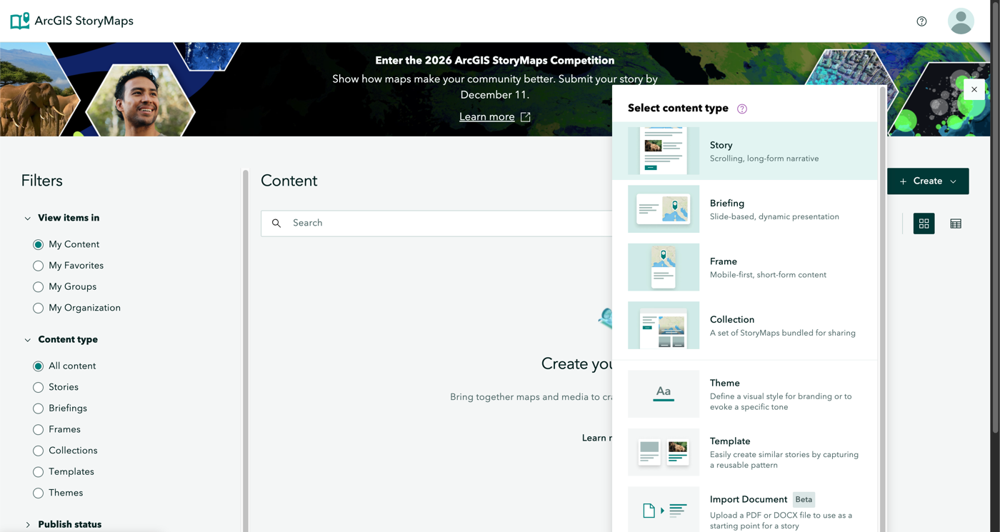
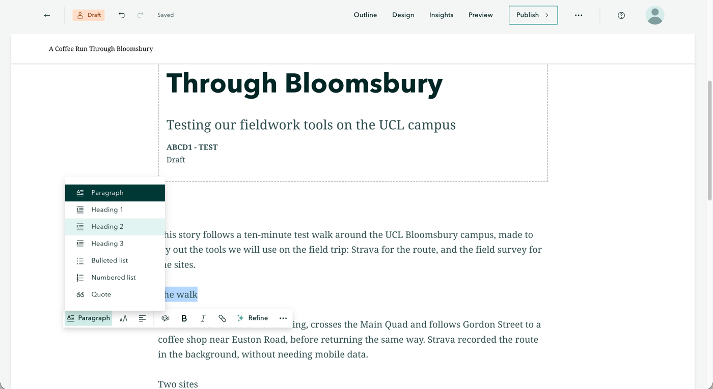
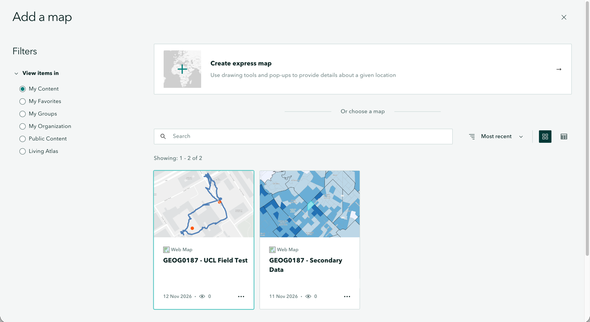
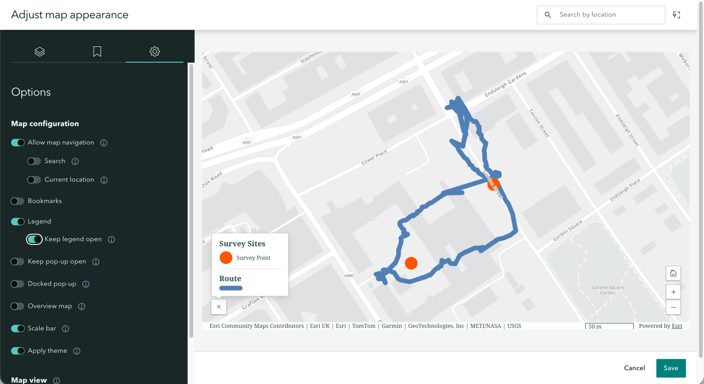
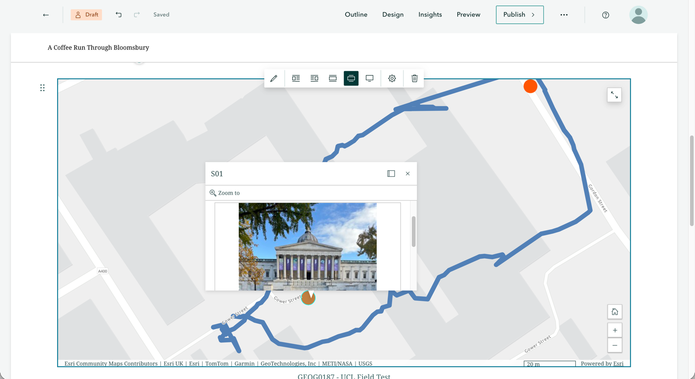
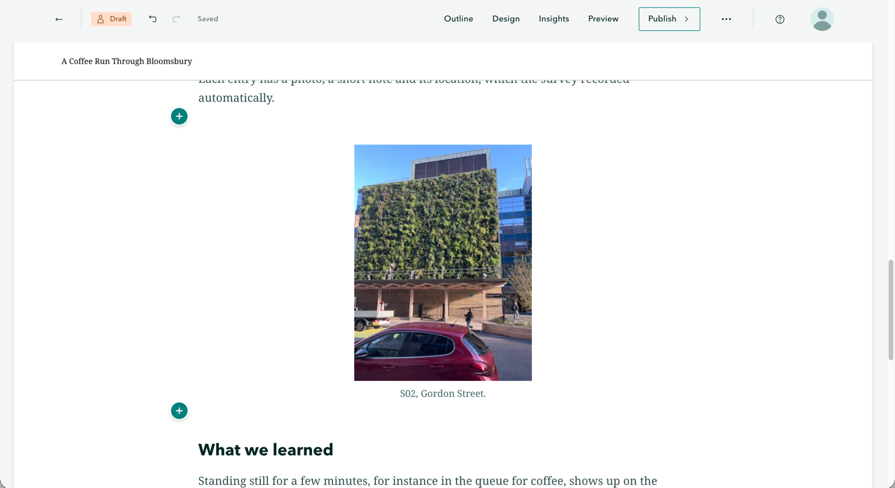
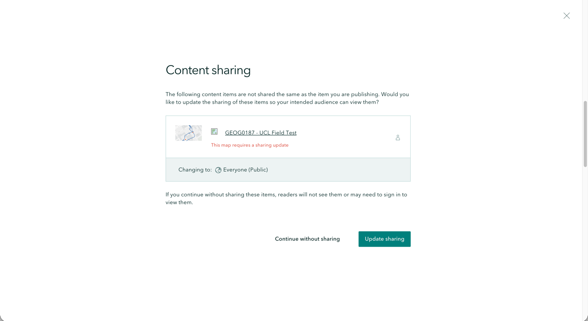
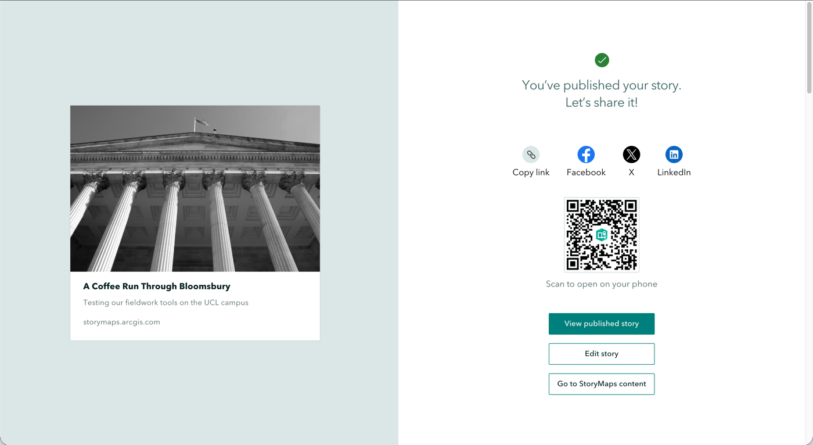
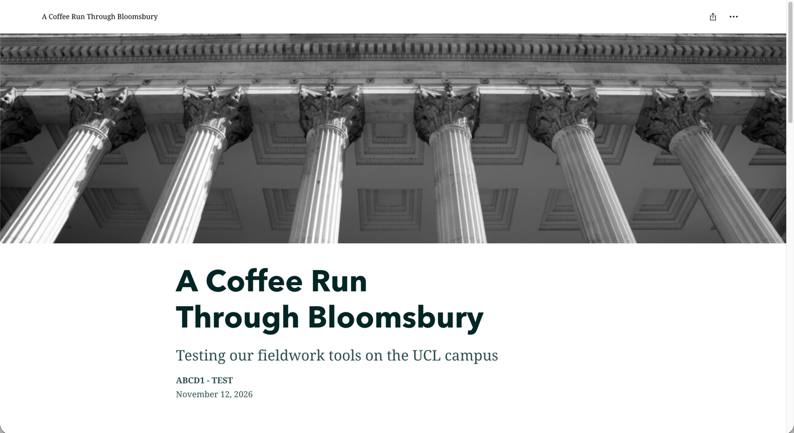

# Building a Story Map

Last week, you made a map of your working group's sites and route. This week, we will use that map as the centre of a **story map**: a web page, built in ArcGIS StoryMaps, that combines text, photos, video and your interactive map to tell a short story about your theme. A story map is also the format of the first GIS worksheet, so what you build in this session is the start of your submission.

::: {.callout-important}
## Before the session
Please make sure you have the following ready before the session starts:

- your saved web map from last week, which you can find in [Content]{.ui} → [My content]{.ui};
- your working group's photos and any videos, downloaded to the laptop you will be working on (your working group shares these in its own OneDrive or Google Drive folder);
- the worksheet brief for this task. The brief sets out what your story map must contain; this chapter shows you *how* to build it.
:::

## What is a story map?
A story map is a scrolling web page in which you can place a map right next to the text it belongs to. The reader scrolls through the story, and can also zoom, pan and click on the map. A good story map has a clear storyline, and every photo, video and map element is there because it supports that storyline.

::: {.callout-tip}
## A proper story map: John Snow and the 1854 cholera outbreak
For a full example, have a look at [*Short revisit to the Cholera Outbreak in Soho, London (1854)*](), a story map designed by Dr Anwar Musah, who also designed the original story map material for this module. It retells John Snow's famous map of cholera deaths around the Broad Street water pump, and shows how text, images and an interactive map can work together. It uses different data and is longer than your story map can be, so use it for inspiration, not as a template.
:::

Your story map must fit the theme your working group was allocated for the Urban Project. It is worth planning the storyline *before* you start building, by asking yourself three questions:

1. What is the one thing you want a reader to understand about your theme in your study area?
2. Which evidence do you have for it: which sites, which photos, and which part of your route?
3. How will you split the story up? The worksheet limits the number of main sections, so decide what each section is for (for instance: the study area and aim, what you observed, and what you learned from the methods and the experience).

Write your headings down before you open the builder. This only takes five minutes, and it saves most of the time you would otherwise lose rearranging blocks.

::: {.callout-note}
## If your screen looks different
ArcGIS StoryMaps changes its layout regularly. This chapter therefore describes *what* to click by its label. If a label has moved or been renamed, look for the closest equivalent, and ask in class if you cannot find it.
:::

## Create the story
Let us start by creating a new story and setting up its cover:

1. Go to []() and sign in with [UCL SSO]{.ui}. Open the app launcher (the grid of nine dots, top right) and click [StoryMaps]{.ui}. StoryMaps opens in a new tab.

   {#fig-app-launcher fig-alt="ArcGIS Online home page with the app launcher open and StoryMaps highlighted"}

2. Click [Create]{.ui} → [Story]{.ui}. This opens the **story builder**, in which you write directly in the page and add content with the [+]{.ui} button that appears between blocks.

   {#fig-create-story fig-alt="ArcGIS StoryMaps content page with the Create menu open and Story at the top of the list of content types"}

3. Click on the title placeholder and type your main title. Keep it short and specific, and make it about your theme rather than something like "My story map". You can add a subtitle underneath.
4. Below the subtitle is the **byline**, which shows your name by default. Replace it with your candidate number and your group code (for example `ABCD1 - CAT1_WG05`, with the group code as in the title of your map). Please do not put your name anywhere in the story: a story map you submit as a formative worksheet does not need to be anonymous, but it may become part of your portfolio, which is marked anonymously, so it is easiest to leave your name out from the start.
5. Choose a cover design that suits your theme, and pick a cover image from your working group's photos.

   {#fig-cover fig-alt="Story builder with a cover titled A Coffee Run Through Bloomsbury, subtitle Testing our fieldwork tools on the UCL campus, byline ABCD1 - TEST, and a photo of columns as cover image"}

Your story is saved automatically as a draft: look for [Draft]{.ui} and [Saved]{.ui} at the top left.

## Add your text
To add text, click below the cover (where it says *Tell your story...*) and start typing. For each of your main sections, select the line with the section title, open the text style menu (it shows [Paragraph]{.ui}), and choose [Heading 1]{.ui}. This gives the story a clear structure. Try to keep paragraphs short, because people read web pages differently from essays.

{#fig-text-style fig-alt="Story builder with the text style menu open, listing Paragraph, Heading 1, Heading 2, Heading 3, Bulleted list, Numbered list and Quote"}

Write for a reader who was not on the trip. Your text should explain the aim, the place, and what you did and learned, in your own words. The worksheet sets the word limit.

::: {.callout-note .exercise icon=false}
## Try it yourself
Once your headings are in place, show only the headings to the person next to you. Can they tell what your story is about, and in which order it will unfold? If not, rework the headings before you write the text.
:::

## Add your map
Next, we will add the web map you made last week:

1. Click [+]{.ui} where the map should go and choose [Map]{.ui}.

   ![The [+]{.ui} menu with [Map]{.ui}.](images/w03/block-menu.png){#fig-block-menu fig-alt="The block menu in the story builder with Text, Button, Separator, Code, Quiz, Map, Chart, Infographic, Table and Image, with Map highlighted"}

2. Under [My Content]{.ui}, click the web map you saved last week.

   {#fig-add-map fig-alt="Add a map panel with My Content selected and two web maps, GEOG0187 - UCL Field Test and GEOG0187 - Secondary Data"}

3. The map opens in [Adjust map appearance]{.ui}. Open the [Options]{.ui} tab (the cog icon), and switch on [Legend]{.ui} and [Keep legend open]{.ui}. Keep [Allow map navigation]{.ui} switched on, so that readers can zoom and pan. Then zoom the map to your study area, which sets the view the reader starts with, and click [Save]{.ui}.

   {#fig-map-options fig-alt="Adjust map appearance with the Options tab open: Allow map navigation, Legend, Keep legend open and Scale bar switched on, next to a preview of the map with its legend"}

4. Click on a point to check that the pop-up still shows the site ID, note and photo. The zoom buttons (bottom right) and the expand button (top right), which opens the map full screen, are added automatically.

   {#fig-map-block fig-alt="Map block in the story with the route, an open pop-up for site S01 showing a photo of the UCL Portico, zoom buttons at the bottom right and an expand button at the top right"}

If you would like the map to change as the reader scrolls through the text, you can try a [Sidecar]{.ui} or [Immersive]{.ui} block. These place the text in a panel that scrolls over a full-screen map. This is a nice extra, but it is not a requirement.

::: {.callout-note}
## The map lives in two places
Your web map is a separate item from your story. If you change the map later, for example to restyle a layer, those changes will show up in the story automatically. Do not delete the web map or its layers before you have submitted.
:::

## Add photos and captions
Photos are where your story comes to life. To add one:

1. Click [+]{.ui} → [Image]{.ui} and upload a photo from your computer. If uploads are slow, resize large photos first.

   ![[Image]{.ui} in the [+]{.ui} menu.](images/w03/image-menu.png){#fig-image-menu fig-alt="The block menu scrolled down to Media, with Image highlighted"}

2. Add a **caption** under every photo that says what it shows and why it matters for your story. If the photo comes from your working group's shared folder, mention this.
3. Add **alt text**, so that the image can be understood by someone using a screen reader: hover over the image, click the options button (the cog), open the [Accessibility]{.ui} tab, and type a short description in [Alternative text]{.ui}. Describe what the photo shows, for example *A building on Gordon Street covered in a green wall of plants*, without starting with "An image of". You can also click [Suggest]{.ui} to let StoryMaps draft the alt text for you with AI: read the suggestion, correct anything that is wrong or missing, and then [Save]{.ui} it.

   {#fig-image-block fig-alt="Image block in the story showing a building with a green wall and a red car, with the caption S02, Gordon Street"}

Choose photos that support your argument: five good photos that you refer to in the text are better than fifteen that only decorate the page.

::: {.callout-note .exercise icon=false}
## Try it yourself
For each photo you plan to use, say in one sentence why it is in your story. If you cannot, leave it out.
:::

## Add video
Short clips from the field can add atmosphere, or an interview, in a way that photos cannot. Adding a video works much like adding a photo:

1. Click [+]{.ui} → [Video]{.ui}.
2. Either [Upload]{.ui} the file, or paste a link from a video site.
3. Add a caption.

Keep your clips short, and check the worksheet for how many are allowed and how long they may be. Only include people who have agreed to be filmed.

## Share and submit {#share-and-submit}
What you submit is the link to your story map, so anyone with the link must be able to open it.

::: {.callout-important}
## Share with Everyone (public), or nobody can see it
A new story is **Private**: only you can see it. If you do not share your story, *and* the map in it, with [Everyone (public)]{.ui}, the marker sees nothing at all, or a story with an empty map. Work that cannot be opened cannot be marked.
:::

Let us publish the story and make sure that this is the case:

1. Click [Publish]{.ui} (top right). Under [Share]{.ui}, change [Private]{.ui} to [Everyone (Public)]{.ui}, and click [Publish]{.ui}.

   ![Choosing [Everyone (Public)]{.ui} in the publish options.](images/w03/publish-options.png){#fig-publish-options fig-alt="Publish options with Story details on the left and the Share drop-down on the right, open on Private, Organization and Everyone (Public)"}

2. StoryMaps then tells you that your web map is not shared the same way as the story. Click [Update sharing]{.ui}, so that the map and its layers become public too. Do not click [Continue without sharing]{.ui}.

   {#fig-content-sharing fig-alt="Content sharing dialog saying the web map GEOG0187 - UCL Field Test requires a sharing update, changing to Everyone (Public), with Continue without sharing and Update sharing buttons"}

3. Your story is now published. Click [Copy link]{.ui} to copy its URL.

   {#fig-published fig-alt="Confirmation page saying You've published your story, with Copy link, social media buttons, a QR code and buttons to view or edit the story"}

4. Open the URL in a private or incognito browser window, which shows you exactly what a marker will see. Check that the map, pop-ups, photos and video all work without being signed in.

   {#fig-private-window fig-alt="The published story open in an incognito window, with the cover photo, title, subtitle and byline ABCD1 - TEST"}

If you change your story after publishing, click [Publish]{.ui} again so that readers see the latest version.

The submission itself is explained in the worksheet brief and on Moodle.

## Before you leave
By the end of this session, your story map should have:

- [ ] a title, and your candidate number and group code in the byline, with no name;
- [ ] your main headings in place, even if some sections are still empty;
- [ ] your web map embedded, with a legend and working pop-ups;
- [ ] at least one photo with a caption;
- [ ] a link that opens when you are signed out.

You have until the worksheet deadline to finish your story map. You can use the remaining time to work on the text, add the remaining photos and videos, and check your story map against the brief.

## Troubleshooting
| Problem | What to try |
| :------ | :---------- |
| I cannot find my web map | Go to [Content]{.ui} → [My content]{.ui}, or search for `GEOG0187`. If you did not save it last week, do that first. |
| The map shows no photos in the pop-ups | Open the web map again and check that [Attachments]{.ui} is switched on under [Pop-ups]{.ui}. |
| The map does not load when signed out | You probably clicked [Continue without sharing]{.ui}. Click [Publish]{.ui} again, and choose [Update sharing]{.ui} this time. Then reload the story in a private window. |
| My name is shown on the cover | Click the byline under the subtitle and replace your name with your candidate number and group code. Your portfolio is marked anonymously. |
| A photo or video upload fails | Reduce the file size, try a different browser, or use a link for the video. |
| I lost my story | Open [StoryMaps]{.ui} from the app launcher: your stories are listed under [My Content]{.ui}. Drafts are saved automatically. |
