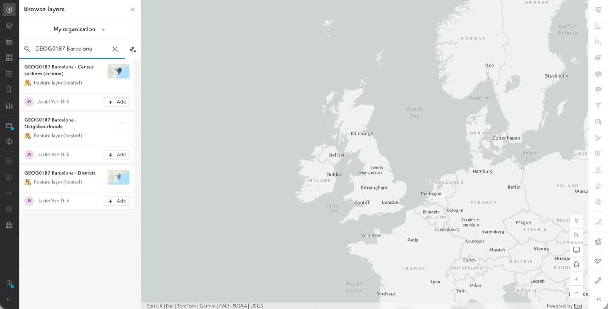
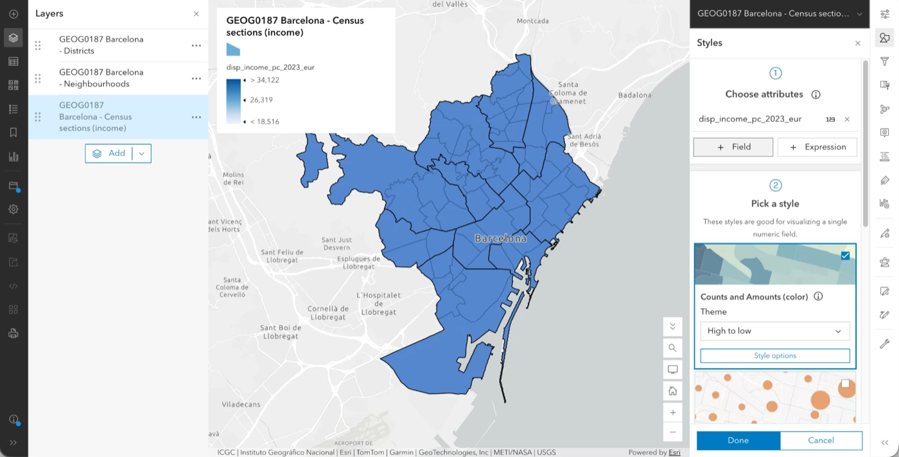
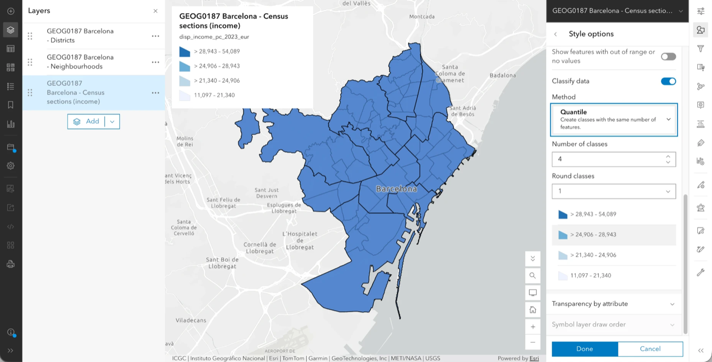
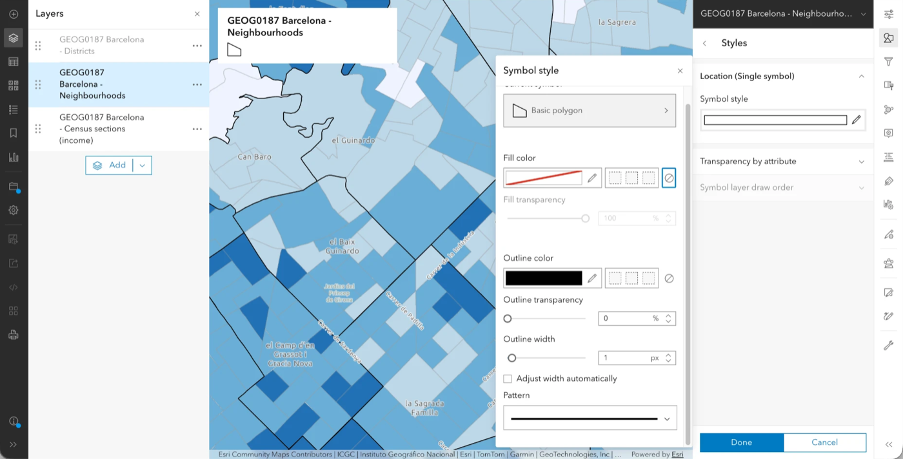
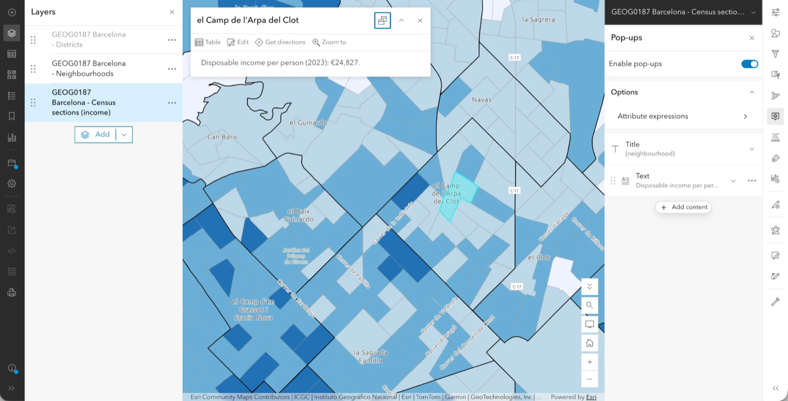

# Using Secondary Data

So far, we have mapped data that you collected yourself. Most of the maps you will come across in geography, however, are made from **secondary data**: data collected by someone else, for their own purposes, and made available for others to reuse. This week, we will look at how to find such data, how to put them on a map, and how to decide whether they are fit for the question you want to answer. These are the skills behind the second GIS worksheet.

::: {.callout-important}
## Before the session
Sign in to ArcGIS Online with [UCL SSO]{.ui} (see [Open Map Viewer](#open-map-viewer)) and have a browser open. You will also need to know your fieldwork city: Barcelona if you went on the Catalonia trip, and London otherwise. Everyone does the same exercise, but with a different data pack.
:::

## Secondary data and where it comes from
Secondary data are produced by organisations such as statistical agencies, city councils, researchers or companies. Before you use any of them, you should find out five things. You will need the answers for your own referencing, as well as for the critical evaluation the worksheet asks for.

| Question | Example |
| :------- | :------ |
| **What** does it measure? | Disposable household income per person (€) |
| **Who** produced it, and **why**? | Barcelona City Council, to monitor inequality |
| **How** was it collected or estimated? | Estimated from tax records and surveys, not a count of every household |
| **When** does it refer to? | Income in 2023 |
| **Where**: for which areas? | 1,068 census sections |

You can usually find these answers in the dataset's description or metadata page, which is one reason why you should always start there rather than with the map.

## Choropleth maps
A **choropleth map** shades areas (polygons) by the value of a numerical variable, such as income, density or deprivation. Choropleth maps are easy to make, but they are also easy to get wrong, because each of the following choices changes what the map seems to say:

- **The variable.** Use *rates* or *averages* (income per person, % of residents) rather than raw totals (total income). Otherwise, areas with more people will look "bigger" for no interesting reason.
- **The classes.** The values are split into groups, each with its own colour. With *equal intervals*, the classes all have the same width; with *quantiles*, they all contain the same number of areas. The same data can look very different depending on which you choose.
- **The colours.** Use a single-hue ramp from light to dark for values that go from low to high, and avoid rainbow palettes.
- **The scale.** The same variable can look different for small areas than for large ones, because averaging over a large area hides the differences inside it. This is known as the [modifiable areal unit problem](https://en.wikipedia.org/wiki/Modifiable_areal_unit_problem) (MAUP).

## Add your data pack
Let us start by opening a new map ([Map]{.ui}) and picking a quiet basemap. You can then follow the instructions for your city.

::: {.callout-tip}
## Left, then right
Remember how Map Viewer is laid out. The left-hand toolbar holds what is *in* your map ([Add]{.ui}, [Layers]{.ui}, [Legend]{.ui}, [Save and open]{.ui}); the right-hand toolbar holds the settings ([Styles]{.ui}, [Filter]{.ui}, [Pop-ups]{.ui}) for whichever layer is selected. So we always work in two steps: first click the layer in [Layers]{.ui} so that it is highlighted, and then click the tool on the right. The name at the top of the right-hand panel tells you which layer you are changing.
:::

### Barcelona
For Barcelona, the data pack consists of three layers that we have prepared for you:

1. Click [Add]{.ui} on the left-hand toolbar → [Browse layers]{.ui}. Switch the drop-down at the top from [My content]{.ui} to [My organization]{.ui}, and search for `GEOG0187 Barcelona`.
2. Add ``. This layer has one polygon per **census section** (the smallest statistical area), with the following attributes:
   - `disp_income_pc_2023_eur`: disposable household income per person, 2023;
   - `mean_taxable_income_2024_eur`: mean taxable income per unit of consumption, 2024;
   - `gini_2024_pct`: the Gini index of tax income, 2024 (a higher value means a more unequal distribution).
3. Add `` and ``, which contain the boundaries of the 73 neighbourhoods and 10 districts. You will use these as context.

{fig-alt="Browse layers panel set to My organization, with the three GEOG0187 Barcelona layers in the search results"}

4. Open [Layers]{.ui} and check the order. The layer at the *top* of the list is drawn on top of the others, so the census sections should be at the *bottom*, with the neighbourhoods above them and the districts at the top. If the order is different, drag the layers by their handle (⠿) on the left.

::: {.callout-note}
## Data source
Barcelona City Council, *Open Data BCN* (CC BY 4.0), based on the Idescat income account and the INE Household Income Distribution Atlas. Sections, neighbourhoods and districts come from the *Administrative units of the city of Barcelona* dataset.
:::

### London
For London, we will use the official deprivation data, which are already available in ArcGIS Online:

1. Click [Add]{.ui} on the left-hand toolbar → [Browse layers]{.ui}. Switch the drop-down at the top to [ArcGIS Online]{.ui}, and search for `` from *gis@communities.gov.uk*.
2. Add the layer. It contains one polygon for every **LSOA** in England (small areas of about 1,500 residents), with the *rank* and *decile* of the Index of Multiple Deprivation (2025).
3. To see only London, click the layer in [Layers]{.ui}, then [Filter]{.ui} on the right-hand toolbar → [Add new]{.ui}. Set `LSOA Name` (`LSOA21NM`) *starts with* the name of a borough (for example `Camden`). You can add more conditions with *or* for any other boroughs you want to include.
4. For context, and to compare scales, also add `` from the same publisher. This layer has one polygon per local authority, including the London boroughs (filter on `LAD24NM`). In [Layers]{.ui}, drag it *above* the LSOAs, and give it no fill and a visible outline (see [Compare scales](#compare-scales) for how).

::: {.callout-note}
## Data source
Ministry of Housing, Communities & Local Government, *English Indices of Deprivation 2025* (Open Government Licence v3.0).
:::

## Make the choropleth
Now that the data are on the map, we can turn the main layer into a choropleth:

1. In [Layers]{.ui}, click the main layer (the census sections, or the LSOAs for London), and then click [Styles]{.ui} on the right-hand toolbar.
2. Under [Choose attributes]{.ui}, click [+ Field]{.ui} and pick the numerical variable: `disp_income_pc_2023_eur` for Barcelona, `IMDRank` for London.
3. Under [Pick a style]{.ui}, select [Counts and Amounts (color)]{.ui} and click [Style options]{.ui}.

{fig-alt="Styles panel with disp_income_pc_2023_eur chosen as the attribute and Counts and Amounts (color) selected"}

::: {.callout-note .exercise icon=false}
## Predict first
With [Equal interval]{.ui}, every class has the same width; with [Quantile]{.ui}, every class contains the same number of areas. In Barcelona, a few sections have much higher incomes than the rest. Which of the two do you expect to show most of the city in the same colour? For London, the variable is a *rank*: do you expect the two classifications to look different at all? Write down your guess before the next step.
:::

4. In [Style options]{.ui}, switch on [Classify data]{.ui}. Under [Method]{.ui}, try [Natural breaks]{.ui}, [Quantile]{.ui} and [Equal interval]{.ui} in turn, and set [Number of classes]{.ui} to 5 each time. Look at how the map and the class limits change. Was your guess right?

{fig-alt="Style options with Classify data switched on, Quantile as the method and the class limits listed underneath"}

5. Choose a single-hue colour ramp. If the polygon outlines clutter the map, switch them off or make them thinner.
6. Click [Done]{.ui}, and open [Legend]{.ui} on the left-hand toolbar. Does the legend make clear what is being shown, and in which units?

Finally, settle on one classification for your map and note down why you chose it: the worksheet asks you to justify this choice.

## Compare scales {#compare-scales}
Next, let us see how much the picture depends on the size of the areas. For this, the boundary layers need to show only their outlines:

1. In [Layers]{.ui}, click the neighbourhoods layer, and then click [Styles]{.ui} on the right-hand toolbar.
2. A boundary layer has only one style, [Location (Single symbol)]{.ui}. Click [Style options]{.ui} under it, and then the pencil next to [Symbol style]{.ui}.
3. Next to [Fill color]{.ui}, click the *no colour* button (the circle with a line through it, on the far right). Keep a dark [Outline color]{.ui}.
4. Close the [Symbol style]{.ui} panel and click [Done]{.ui}.
5. Do the same for the districts, with a thicker outline (for example 2 or 3 px under [Outline width]{.ui}), so that you can tell the two apart.

{fig-alt="Symbol style panel for the neighbourhoods layer, with the no colour button selected for the fill and a black outline"}

6. Zoom into one district.

::: {.callout-note .exercise icon=false}
## Predict first
Do you expect income to vary more *between* neighbourhoods or *within* them, between the census sections of a single neighbourhood? Then compare a few neighbourhoods on the map and check.
:::

::: {.callout-note .exercise icon=false}
## Try it yourself
If you are working with the London data, do the same with the boroughs. Compare the pattern of LSOAs *within* a borough with the single borough outline. Why might one borough-level summary hide a lot?
:::

## Write the pop-up
A good pop-up does more than just show numbers. Let us set one up for the main layer:

1. First, switch off the pop-ups of the boundary layers. Otherwise, clicking on the map opens the neighbourhood or district instead of the census section. In [Layers]{.ui}, click the neighbourhoods layer, then [Pop-ups]{.ui} on the right-hand toolbar, and switch off [Enable pop-ups]{.ui}. Do the same for the districts (or the boroughs, for London).
2. Now click the main layer in [Layers]{.ui}, and then [Pop-ups]{.ui} on the right-hand toolbar.
3. Click [Title]{.ui} and set it to the neighbourhood (Barcelona) or the LSOA name (London).
4. By default, the pop-up also contains a [Fields list]{.ui} with every attribute in the layer. Remove it by clicking the [⋯]{.ui} next to [Fields list]{.ui} → [Delete]{.ui}.
5. Click [Add content]{.ui} → [Text]{.ui}, and then [Edit text]{.ui}. Write the value with a clear name and unit, for example *Disposable income per person (2023): €{disp_income_pc_2023_eur}*. To avoid typos in the field name, insert it with the [{}]{.ui} button in the text toolbar rather than typing it.
6. Below that, add a short interpretive note: one sentence on what the value means in context. Click [OK]{.ui}.

7. Click on a few areas to check the result.

{fig-alt="Pop-up for a census section in el Camp de l'Arpa del Clot showing its disposable income per person, next to the Pop-ups panel with a title and one text block"}

## Evaluate your data
To finish, choose one variable from your data pack and answer the five questions from [Secondary data and where it comes from](#secondary-data-and-where-it-comes-from). Then think of two or three limitations of the data. The following questions can help you with this:

- **Scale:** what is hidden when we show averages for areas?
- **Completeness:** are there areas missing? In the Barcelona layer, `mean_taxable_income_2024_eur` is empty for three sections. Why might these data be missing?
- **Method:** is the variable a count, an estimate or the output of a model? (The London index gives *ranks*: what does a rank not tell you?)
- **Time:** does the data refer to the same year as your fieldwork?
- **Bias:** who is more likely to be missing from, or poorly represented in, the underlying data?

Keep your answers as notes, because you will need them for the worksheet.

## Save your map
Save your map via [Save and open]{.ui} → [Save as]{.ui}, with a title such as `GEOG0187 – Secondary data – Surname`. You will build on this map for the second story map.

## Before you leave
By the end of this session, you should have:

- [ ] your main layer shaded by one numerical variable;
- [ ] a context layer (boundaries) on the map;
- [ ] a legend that explains the variable and its units;
- [ ] a pop-up with a value and an interpretive note;
- [ ] notes on the five questions and two or three limitations of your data.

## Find your own data
For the worksheet, you do not have to use the data pack above. If you would like to find your own data, the following are good places to start:

- ArcGIS Living Atlas, via [Add]{.ui} → [Browse layers]{.ui} → [Living Atlas]{.ui}.
- Open Data BCN ([opendata-ajuntament.barcelona.cat](https://opendata-ajuntament.barcelona.cat/en/)) for Barcelona.
- The London Datastore ([data.london.gov.uk](https://data.london.gov.uk)), the ONS ([ons.gov.uk](https://www.ons.gov.uk)) and data.gov.uk for London and the UK.

Whichever source you use, check the licence, and always record the name, publisher and year of the dataset for your references.

## Troubleshooting
| Problem | What to try |
| :------ | :---------- |
| The Barcelona layers do not appear | Search [My organization]{.ui}, not [My content]{.ui}, and check that you signed in through [UCL SSO]{.ui}. Let staff know if the layers are missing. |
| The London layer is slow or looks wrong | Apply the borough filter first, and then zoom in. |
| The map looks like it is all one colour | Check the classification and the number of classes, and try *quantile*. |
| The legend shows odd numbers | Edit the legend labels, or round the values in the style options. |
| Clicking the map opens a neighbourhood, district or borough | Switch off [Enable pop-ups]{.ui} for the boundary layers (see [Write the pop-up](#write-the-pop-up)). |
| The boundary layers hide the colours underneath | Set their fill to *no colour* (see [Compare scales](#compare-scales)), and check that they are above the main layer in [Layers]{.ui}. |
| A value is empty in the pop-up | The data may be missing for that area. If so, mention this in your evaluation. |
