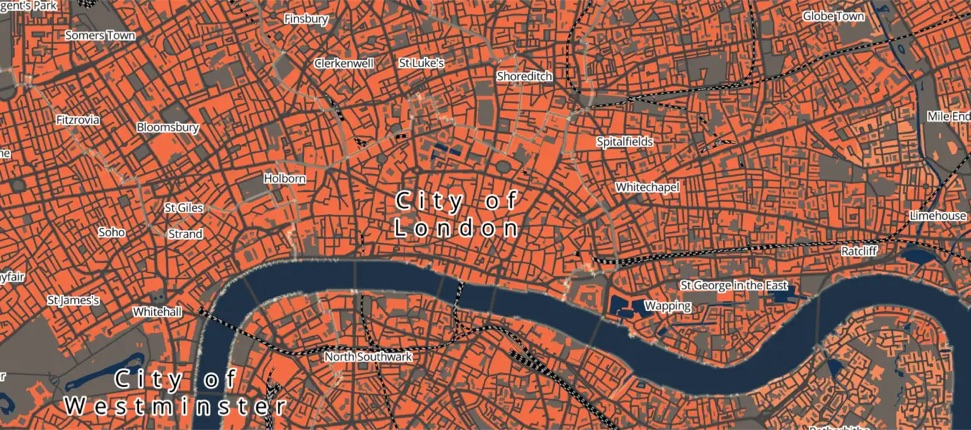

# Quantitative Skills {.unnumbered}

{width=100% fig-alt="Map of central London showing the Access to Healthy Assets and Hazards index by neighbourhood"}

## Welcome {.unnumbered}
Welcome to the **Quantitative Skills** strand of **GEOG0187 Foundations of Geography II**. This term has three parts:

- **Spatial Data Collection.** Before the field trip to Catalonia, you prepare to collect your own spatial data: the routes you walk and the sites you record.
- **Mapping.** After the trip, you map your field data in ArcGIS Online, turn it into a story map, and learn to work with and evaluate secondary data.
- **Statistics.** Finally, you use R to describe data, quantify uncertainty, and compare groups.

## Moodle {.unnumbered}
[Moodle](https://moodle.ucl.ac.uk/) is the central point of contact for GEOG0187 and it is where all important information will be communicated, such as session dates, group allocations and assessment information. This workbook contains the material for the Quantitative Skills sessions.

## How the sessions work {.unnumbered}
Each session starts with a short introduction, after which you work through the material in this workbook at your own pace, with Affiliate Lecturers and Teaching Assistants on hand to help. Some sessions ask you to do a short task *before* you come to class: this is flagged at the top of the relevant chapter.

## Module overview {.unnumbered}
The topics are listed below. Chapters are released ahead of each session; check Moodle for the exact dates.

| Session | Section     | Topic |
| :------ | :---------- | :---- |
| 1       | Spatial Data Collection | [Collecting Spatial Data]() |
| 2       | Mapping     | [Mapping Your Field Data]() |
| 3       | Mapping     | Telling Stories with Maps |
| 4       | Mapping     | Working with Secondary Data |
| 5       | Statistics  | Describing Data |
| 6       | Statistics  | Samples and Uncertainty |
| 7       | Statistics  | Comparing Groups |

## Acknowledgements {.unnumbered}
This workbook is created using the [Quarto](https://quarto.org/) publishing system. Elements of this workbook are partially based on and modified from:

- Previous [GEOG0013: Geography in the Field 1](https://www.ucl.ac.uk/module-catalogue/modules/GEOG0013) GIS content created by Anwar Musah
- The [GEOG0018: Methods in Human Geography](https://jtvandijk.github.io/GEOG0018/) workbook by [Justin van Dijk](https://www.mappingdutchman.com)
